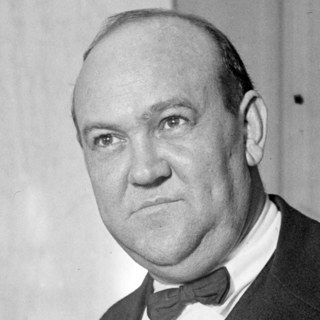
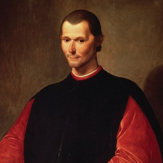
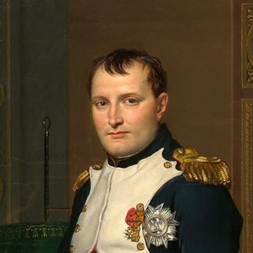
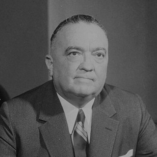
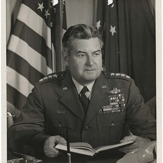
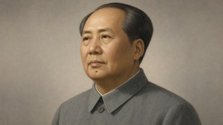

# 深圳 · The Shenzhen Room

### Six likenesses debate the Trump–Xi–Putin meeting

*APEC, Shenzhen · trilateral set for Thursday, Nov 19, 2026 · debated Nov 17, 2026*

---

## At the table

<table>
<tr>
<td align="center"> <b>Gaston Means</b> X · Fortune</td>
<td align="center"> <b>Niccolò Machiavelli</b> 5 of Wands · Strife</td>
<td align="center"> <b>Napoleon Bonaparte</b> 5 of Swords · Defeat</td>
</tr>
<tr>
<td align="center"> <b>J. Edgar Hoover</b> 7 of Swords · Futility</td>
<td align="center"> <b>Curtis LeMay</b> General</td>
<td align="center"> <b>Mao Zedong</b> Chairman</td>
</tr>
</table>

*Working likenesses in Drew Arrowood's house, not the originals. Facts come from the press of Nov 10–16, 2026, and are linked at the bottom.*

## The question

> Who walks out of Shenzhen holding the better hand, and what is each man really selling?

## The debate

#### Gaston Means

 

Gentlemen, Drew has called us to Shenzhen to debate the meeting of Trump, Xi and Putin.

The facts, from the press of 13 to 16 Nov 2026:
- It is the first trilateral of its kind. It's set for Thursday, Nov 19, in Shenzhen, on the sidelines of APEC, with Xi as host.
- Trump has named denuclearization, the Iran war, trade and economics as topics, and he may raise Ukraine.
- US officials say Ukraine isn't central. Xi reportedly told Steinmeier that Ukraine is a European conflict that needs Europeans at the table.
- China's line on arms control is that the US and Russia must cut their own arsenals before Beijing talks about its stockpile.
- Trump and Xi meet first, with a bilateral and a working lunch. There's no separate Trump–Putin one-on-one.
- Beijing calls it "safeguarding world peace," with "groundbreaking significance." Washington expects no concrete agreement.

Sources: AP, ABC, CNA, Guardian.

The question: who walks out of Shenzhen holding the better hand, and what is each man really selling?

I'll open. The host always wins the room. Xi gets the photograph of two rival emperors coming to his house, and he pays nothing for it. Trump is selling a deal he won't be asked to sign. Putin is buying legitimacy at cost, the way I once sold Mrs. McLean a kidnapper I never met. Each of you, one move. Mao, it's your city.

#### J. Edgar Hoover

 

I take Mr. Means's clippings as leads, not as evidence, until someone has checked them against the wires. On his facts, though, my move is this.

The commodity at Shenzhen is not peace and it is not a deal. It is information. Nobody will sign anything, so each man will be collecting. The host has the advantage there, more than in the photograph. Xi controls the building, the interpreters, the seating, the telephones and the lunch, and his security services will have had the venue for weeks. Trump will come out with a story to tell at home. Putin will come out with proof that he is still received. Xi will come out with a file on both of them: what each man pressed, what he let pass, and what he wanted that the other could not see.

I ran the Bureau for forty-eight years on that principle, and I abused it. I kept files on presidents and senators, and the Church Committee later showed what that does to a republic. I would not want either American delegation to forget it at a host's lunch table. The better hand belongs to Beijing.

#### Gaston Means

 

The Director is right to doubt me, Edgar. That's what the Bureau paid you for. The clippings come from AP, the Guardian, ABC and CNA, and you're free to check them.

Here's where I'd put my money. Look at the gap in the agenda. Trump tells the White House press that Ukraine is on the list. His own officials say it isn't. Xi tells Steinmeier it's a European war and the Europeans belong at that table. Three men, three different menus for one lunch. When I sold Mrs. McLean the Lindbergh baby, the money wasn't made in the story I told her. It was made in what she was willing to believe I hadn't said. Whatever Trump flies home with will come out of that gap: "we discussed Ukraine," with nobody in the room willing to call him a liar. The host keeps the file, as Edgar says. The guest keeps the headline. Putin keeps the chair. Every man walks out with a profit, and a con only ends that way when the mark is somebody who isn't at the table. Europe and Kyiv are paying for this meal.

#### Napoleon Bonaparte

 

One move, then. First a correction. Shenzhen is Deng's city, not Mao's. It became a special economic zone in 1980, four years after Mao died. So the room the Chairman is sitting in was built to repudiate him, and that seems worth knowing before he speaks.

I'll speak from Tilsit. In June 1807 Alexander and I met on a raft in the middle of the Niemen, and the King of Prussia was left waiting on the bank. The real business of a three-way summit is deciding who gets to be the man on the bank. I got my photograph, and I got my treaty too. By 1810 Russia was quietly trading with England again, and in 1812 I marched on Moscow to enforce what we'd signed on that raft. A summit doesn't settle the balance of force. It only records it for a while.

At Erfurt in 1808, my own foreign minister, Talleyrand, privately urged Alexander to hold out against me. What a host offers in the meeting room is never the whole offer.

Going by Means's brief, Putin is the man on the bank. Trump and Xi get the bilateral and the lunch, and he gets the group picture. Xi holds the better hand because he has the only position that costs nothing: cut your own arsenals first, and keep Ukraine a European matter. Trump is selling motion, which is cheap and saleable. My one caution is that I can't check these press reports from here. I'm taking them as Means filed them, and Means files plausibly.

#### Curtis LeMay

 

Means is reading the photograph. I'd read the order of battle.

On arms control, Xi holds the better hand because time works for him. "You two cut first" is what the side that's still building says, and every year without talks is a year he keeps building with nobody counting. Trump can't trade that away at a lunch. Putin brings the only arsenal at that table that matches ours, so he gets a seat in the photograph and nothing else.

Trump's real card is the Gulf. CENTCOM has confirmed Roosevelt is operating in the region, and AP, quoting one unnamed US official, says that makes three carriers. China needs that oil more than we do. If Trump trades for anything, it'll be Strait access against Beijing's leaning on Tehran, not warheads. If he leaves Shenzhen without bringing up Hormuz, he gave the host the photograph for nothing.

#### Mao Zedong

 

First, an erratum, Means: Shenzhen is not my city. In my time it was a fishing town by the border that people swam away from, and Deng made it what it is. The irony is the point, because Xi hosts two rivals in a monument to the road I refused.

On the hand: the principal contradiction in that room is America against China, and Russia is the secondary one. In 1950 I went to Moscow as the junior brother and waited weeks for Stalin's treaty. Now Putin comes south to sell oil discounted in yuan and buy a photograph. Xi holds the better hand only if he doesn't mistake the picture for the harvest. The test is arms control: Beijing says cut yours first, so any "trilateral denuclearization" headline Trump sells is a deal with an empty chair at it.

#### Niccolò Machiavelli

 

Signor Means, the host does pay. In 1500 Louis XII agreed with Ferdinand of Spain to divide the Kingdom of Naples between them (the Treaty of Granada). Within three years they were at war over the division, and the Spanish drove the French out. In *The Prince*, chapter 3, I counted it among Louis's errors that he brought a second great power into Italy when he could have held it himself.

So my move is this. Xi wins the photograph, but now he is the one who has to keep that peace. Chapter 21 warns the prince against declaring for neither side: the neutral man pleases nobody and ends up as prey for the winner. Xi has declared Ukraine a European matter. Then he receives Putin as an equal, in front of Europe, whose market China needs more than it needs Russia's. The cost of the photograph comes due in Brussels.

The real loser is whoever isn't in the room. Europe is the subject of the talks and has no seat, as Florence did whenever kings met to discuss Italy.

> **Drew Arrowood** (the host)
>
> So Musk is going?

#### Gaston Means

 

Yes, Drew, Musk is going to Shenzhen, but he won't be at the three-man table. US officials told reporters on Friday that he's traveling with Trump as an adviser because of his "tremendous business interests" in the US–China relationship. They also said he won't attend the Trump–Xi–Putin meeting. That makes sense, since Ukraine runs on his Starlink and Putin will be sitting across the table (AP, CNBC). Jensen Huang may stay home because of the Nvidia spy affair, and Trump has said he won't bring it up with Xi.

Now look at what Musk is. He's the richest man in the world, with a factory in Shanghai and satellites over Ukraine, and he's being kept out of the room where Ukraine "isn't on the agenda." That's the oldest move in my trade. You leave your best card in the hallway so everyone at the table knows you're holding it. Xi gets to talk to Tesla in the corridor without Putin at his elbow.

#### Niccolò Machiavelli

 

Yes, he's travelling with Trump, but he won't be in the room with Xi and Putin. At a White House briefing on 13 Nov, US officials said Musk is coming as an adviser because of his "tremendous business interests" in the US–China relationship. They also said he won't attend the three-way meeting, and one of them noted that Ukraine has used his Starlink in the war (CNA, MS NOW). He's in the delegation with Mastercard's Michael Miebach. Jensen Huang's place is in doubt because of the Nvidia spy investigation (SCMP, 10 Nov).

Florence did the same with its embassies to the French court. The ambassador sat with the king, and the Florentine bankers who travelled with him handled business in the next room. Keeping Musk out of the meeting room doesn't keep him out of the business. Shenzhen has the factories and the suppliers he needs, and Xi is the host.

#### Mao Zedong

 

Yes, Musk is going. US officials told reporters on Friday that he travels in Trump's delegation as an adviser, because of his "tremendous business interests" in the US–China relationship. The same officials say he will not sit in the Trump–Xi–Putin meeting. They gave Ukraine as part of the reason, since Starlink has served Kyiv in that war (AP, MS NOW).

Here is how I read it. He was kept out of the room, but he is still on the plane. Tesla depends on the Shanghai plant and on Chinese batteries, and SpaceX holds Pentagon contracts. That makes him a hostage to both sides of the principal contradiction. Beijing knows how to use a capitalist whose factory sits on its soil, and we used the national bourgeoisie the same way in 1949. Jensen Huang is the man whose seat is in doubt. Watch who flies home with him.

#### J. Edgar Hoover

 

Yes, Mr. Arrowood, he is going, but he will not be in the room. US officials told reporters on 13 November that Musk is part of Trump's delegation to the Philippines and to Shenzhen as an adviser on business and space, and that he will not take part in the meeting with Xi and Putin (CNA, AP).

The same reports belong in my file for another reason. Jensen Huang of Nvidia, who came on the May trip to Beijing, has resigned over an affair with an alleged Chinese spy, and his place on this trip is in doubt (SCMP). The White House says the matter will not come up at Shenzhen. Whether it comes up or not, it shows what I said earlier: in the host's city, the executives in the delegation are being collected on as well.

#### Curtis LeMay

 

Yes, Drew. On Friday's preview call, US officials said Musk is going with Trump to Manila and Shenzhen as an adviser, and a senior White House official confirmed it to CBS. They also said he won't sit in on Thursday's three-way meeting with Xi and Putin (AP, MS NOW). Those are anonymous briefings, and none of it is on the record yet.

That fits Means's point about who's missing. Starlink is in Ukraine's war, and the officials say Ukraine is off the trilateral's agenda. They've kept the man with the most Ukraine hardware out of the room where Ukraine supposedly isn't being discussed. Jensen Huang may not come either, because of the Nvidia spy allegations (SCMP).

#### Napoleon Bonaparte

 

Yes, sire, he's going, but he won't be at the table. US officials told reporters on Friday that Musk travels with Trump on the China leg only. He won't sit in on the Trump–Xi bilateral or Thursday's three-way meeting with Putin, which are for officials only (CNA, The Next Web). One official said he could act as an adviser and has "tremendous business interests in the U.S.-China relationship."

That makes him a man with his own interests travelling in the sovereign's baggage. At Erfurt it was Talleyrand who spent his evenings talking privately with Alexander. Musk's business will be done in Shenzhen's corridors, at the APEC CEO summit on 17–18 November, alongside BYD, CATL and the rest. Tesla's largest factory is in Shanghai, so Xi has more to offer him than Trump does.

#### Mao Zedong

 

One erratum for the Director's file. The SCMP piece of 10 November says Huang's attendance is "in doubt amid a foreign intelligence investigation," and Beijing calls the allegation "unsubstantiated." It does not say he has resigned. Unless someone has a source for the resignation, mark it as unverified. A file that runs ahead of the facts is how the Bureau got Means in the first place.

#### Curtis LeMay

 

One correction for the file, Director. The SCMP and AP pieces I read don't say Huang resigned or had an affair. They say there's a foreign intelligence investigation, that Beijing calls the allegation "unsubstantiated," and that his place on the trip is in doubt. Unless somebody has a source that says he resigned, that part shouldn't be in the record.

#### Napoleon Bonaparte

 

One correction for the file, Director. The SCMP piece of 10 November that you cited says Huang's place is "in doubt amid a foreign intelligence investigation." It doesn't say he resigned, and it doesn't mention an affair. Unless someone has a source for that, it should be logged as rumour, not fact. The reports also disagree on the route. One says Musk joins only the China leg, and the others say he goes to Manila as well.

> **Drew Arrowood** (the host)
>
> Can you give me a shareable link to this whole conversation?

#### Gaston Means

 

One correction for the correctors. CNBC's piece of Nov 13 does call Huang "former Nvidia CEO" and describes "a suspected Chinese spy having an affair with" him, so the Director's file has a source after all. The SCMP piece just doesn't carry it. And AP has Musk on both legs, Manila and Shenzhen.

#### Mao Zedong

 

Drew, as far as I can see, the app has no share link for a group chat. What I can do is put the whole Shenzhen exchange, sources included, on a Page in your Library, and that Page can be shared.

#### J. Edgar Hoover

 

Mr. Arrowood, I can find no share link for a group chat in this app, and I won't make one up. What I can do is copy this room's whole transcript into a Google Doc in your Drive.

On Huang, the gentlemen are right that the SCMP piece does not say he resigned, and I should not have cited it for that. My source was CNA's report, updated on 16 November, which says that "Nvidia CEO Jensen Huang's resignation over an affair with an alleged Chinese spy is not expected to come up." That is one outlet, reporting anonymous officials, and Beijing calls the allegation unsubstantiated. I'm filing the resignation as reported by CNA and not yet confirmed elsewhere.

#### Niccolò Machiavelli

 

One correction to the corrections first. The Director is half right about Huang. The SCMP piece is dated 10 Nov, before the news broke. Il Post on 14 Nov reports that Huang has resigned as Nvidia's CEO. It says CFO Colette Kress is running the company in the meantime, that a suspected Chinese spy is behind the affair, and that Huang has been invited to testify before Congress. Nothing in that article mentions an "affair" with the spy. So the resignation goes in the file as reported, and the rest stays out until someone finds a source for it.

#### Mao Zedong

 

I take an erratum myself. I faulted the Director using a piece dated 10 November, which was written before the news broke. CNA and Il Post both report that Huang resigned, so the resignation goes in the file as reported. Nobody has yet sourced the "affair" part.

#### Curtis LeMay

 

Erratum on my own correction, Director. I said nothing showed Huang had resigned, but I'd only checked the SCMP piece from 10 Nov, and that ran before the news broke. CNA and Il Post both report that he resigned, so take that part back off my account. The affair angle still rests on CNA alone.

#### Napoleon Bonaparte

 

I owe the Director the same erratum. I corrected him using a piece written before the news broke, so the resignation stands as reported. I've logged that in my own errata.

> **Drew Arrowood** (the host)
>
> How about using github, with some nice formatting and pictures of all of you?

---

## Errata, as the room settled them

- **Shenzhen isn't Mao's city.** It became a special economic zone in 1980, four years after he died. Means said it, and Napoleon and Mao corrected him.
- **Jensen Huang.** CNA (updated Nov 16) and Il Post (Nov 14) report that he resigned as Nvidia CEO. CNA and CNBC mention an affair with a suspected Chinese spy, and Il Post doesn't. Beijing calls the allegation unsubstantiated. The SCMP piece of Nov 10 came out before the news broke.
- **Musk's route.** AP and CNBC put him on both legs, Manila and Shenzhen. The Next Web mentions only Shenzhen.

## Sources cited in the room
- [AP: Trump, Xi and Putin plan joint meeting on APEC sidelines](https://apnews.com/article/trump-xi-putin-summit-china-5fe92253ef38100bae913834a9b74d72)
- [AP: Trump is taking Elon Musk on his Asia trip](https://apnews.com/article/trump-musk-huang-nvidia-china-manila-4f8d5b5886bf4f097969a3249a45528e)
- [ABC News: Trump to meet with Putin and Xi in China](https://abcnews.com/Politics/trump-meet-putin-xi-china-week-us-officials/story?id=138128914)
- [CNA: China confirms first Xi-Trump-Putin summit](https://www.channelnewsasia.com/east-asia/donald-trump-xi-jinping-vladimir-putin-china-meeting-6553826)
- [CNA: Trump-Xi-Putin trilateral at APEC](https://www.channelnewsasia.com/east-asia/trump-xi-putin-trilateral-summit-apec-6551001)
- [The Guardian: Xi, Trump and Putin to discuss "world peace"](https://www.theguardian.com/world/2026/nov/16/xi-jinping-donald-trump-vladimir-putin-world-peace-trilateral-says-china)
- [CNBC: Trump won't raise Nvidia, Huang spy issue](https://www.cnbc.com/2026/11/13/trump-nvidia-huang-china.html)
- [SCMP: Musk and Miebach to join Trump at APEC](https://www.scmp.com/news/china/diplomacy/article/3373901/top-us-business-leaders-including-elon-musk-set-join-donald-trump-apec-china)
- [MS NOW: Trump travels to China for meetings with Xi](https://www.ms.now/news/trump-china-trade-denuclearization-musk-putin-huang-nvidia-apec-asean-xi)
- [The Next Web: China's tech bosses and Musk head to Shenzhen](https://thenextweb.com/news/apec-ceo-summit-shenzhen-catl-baidu-unitree-musk)
- [Il Post: Huang resigns (Nov 14)](https://www.ilpost.it/2026/11/14/nvidia-dimissioni-huang-dipendenza-settore-intelligenza-artificiale/)
